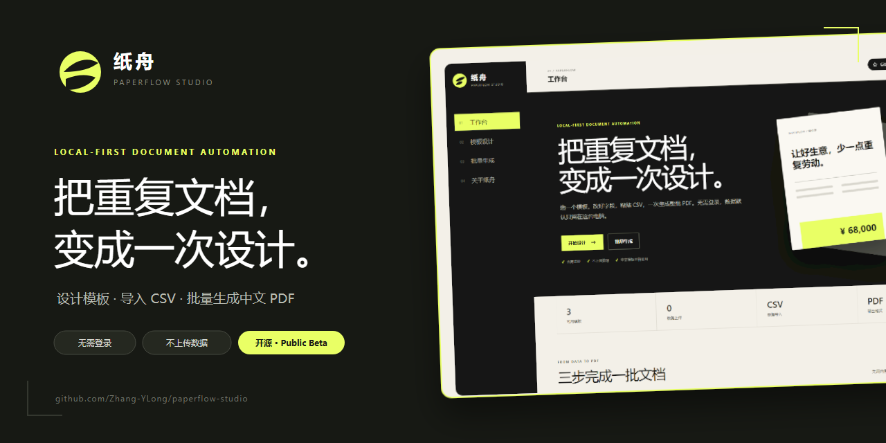

<p align="center">
  
</p>

<h1 align="center">纸舟 PaperFlow Studio</h1>

<p align="center">
  设计一次，导入 CSV，批量生成中文 PDF。
</p>

<p align="center">
  <a href="https://zhang-ylong.github.io/paperflow-studio/"><strong>在线体验</strong></a>
  ·
  <a href="https://github.com/Zhang-YLong/paperflow-studio/releases"><strong>下载本地版</strong></a>
  ·
  <a href="https://github.com/Zhang-YLong/paperflow-studio/issues/new/choose"><strong>提交反馈</strong></a>
</p>

<p align="center">
  <a href="https://github.com/Zhang-YLong/paperflow-studio/actions/workflows/ci.yml"></a>
  
  
  
</p>



纸舟是我做的一款本地优先 PDF 工具。它解决的问题很具体：同一类报价单、证书或标签，只是数据不同，就不该每次都重新复制、排版和检查。

模板设计一次，之后换数据就够了。

## 一分钟走完主流程

1. 打开[在线版](https://zhang-ylong.github.io/paperflow-studio/)，选择一套内置模板。
2. 在[模板设计器](https://zhang-ylong.github.io/paperflow-studio/?page=designer)里拖拽字段，保存修改。
3. 进入[批量生成](https://zhang-ylong.github.io/paperflow-studio/?page=batch)，粘贴 CSV，下载合并后的 PDF。

不用注册，也不需要先配置数据库或第三方服务。

## 现在能做什么

| 能力 | 当前实现 |
| --- | --- |
| 可视化设计 | 文字、图片、表格、二维码、签名和形状 |
| 中文模板 | 报价单、结业证书、发货标签 |
| 批量生成 | 一行 CSV 对应一页，输出单个多页 PDF |
| 模板保存 | 浏览器本地保存，支持 JSON 导入与导出 |
| 中文字体 | 内置 Noto Sans CJK，不依赖在线字体服务 |
| 数据处理 | 模板编辑、CSV 解析和 PDF 生成均在浏览器内完成 |

<table>
  <tr>
    <td width="50%"></td>
    <td width="50%"></td>
  </tr>
  <tr>
    <td align="center">拖拽调整模板与字段</td>
    <td align="center">粘贴 CSV，批量生成 PDF</td>
  </tr>
</table>

## 适合这些重复文档

- 每次只替换客户、价格和日期的报价单
- 一次生成几十或几百份的证书
- 来自表格数据的发货标签、物料标签
- 字段结构固定、内容反复变化的通知书

如果你的文档每一份布局都完全不同，纸舟目前并不适合；它更擅长“模板固定、数据变化”的任务。

## 数据保存在哪里

- 当前版本没有账号、埋点或纸舟后端服务。
- 模板默认保存在浏览器的 `localStorage` 中。
- 清除浏览器站点数据会同时清除本地修改。
- 重要模板建议使用“导出模板”保存一份 JSON 备份。

## Windows 本地版

1. 从 [Releases](https://github.com/Zhang-YLong/paperflow-studio/releases) 下载 ZIP 并解压。
2. 安装 [Node.js 20.19 或更高版本](https://nodejs.org/)。
3. 双击 `启动纸舟Studio.cmd`。

本地版当前仍依赖 Node.js，这是 Beta 阶段的一个已知限制。想直接体验的话，推荐先使用[在线版](https://zhang-ylong.github.io/paperflow-studio/)。

## 本地开发

```bash
git clone https://github.com/Zhang-YLong/paperflow-studio.git
cd paperflow-studio
npm ci
npm run dev
```

提交前运行：

```bash
npm test
npm run build
```

更详细的提交方式见 [CONTRIBUTING.md](CONTRIBUTING.md)。

## 反馈与参与

纸舟还在早期，我会优先处理真实使用中遇到的问题：

- 遇到错误：提交 [Bug 报告](https://github.com/Zhang-YLong/paperflow-studio/issues/new?template=bug_report.yml)
- 想要新能力：提交 [功能建议](https://github.com/Zhang-YLong/paperflow-studio/issues/new?template=feature_request.yml)
- 想聊具体场景：前往 [Discussions](https://github.com/Zhang-YLong/paperflow-studio/discussions)

能复现的步骤、浏览器版本和脱敏后的示例，比一句“不能用”更容易定位。

> 如果纸舟刚好帮你省下了一些重复操作，欢迎给这个仓库一个 Star。它会让我知道这个方向值得继续，也方便你以后回来找到它。

## 开源说明

纸舟 Studio 使用 [MIT License](LICENSE)。

PDF 相关能力基于 [pdfme](https://github.com/pdfme/pdfme) `6.1.12`，中文字体为 Noto Sans CJK。对应的版权和许可证文本保存在 [THIRD_PARTY_NOTICES.md](THIRD_PARTY_NOTICES.md) 与 [LICENSES](LICENSES)。
