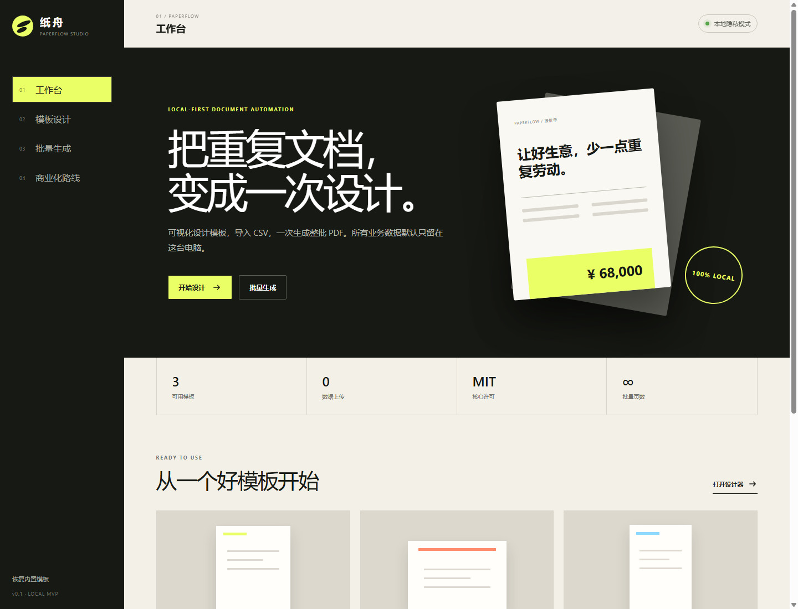
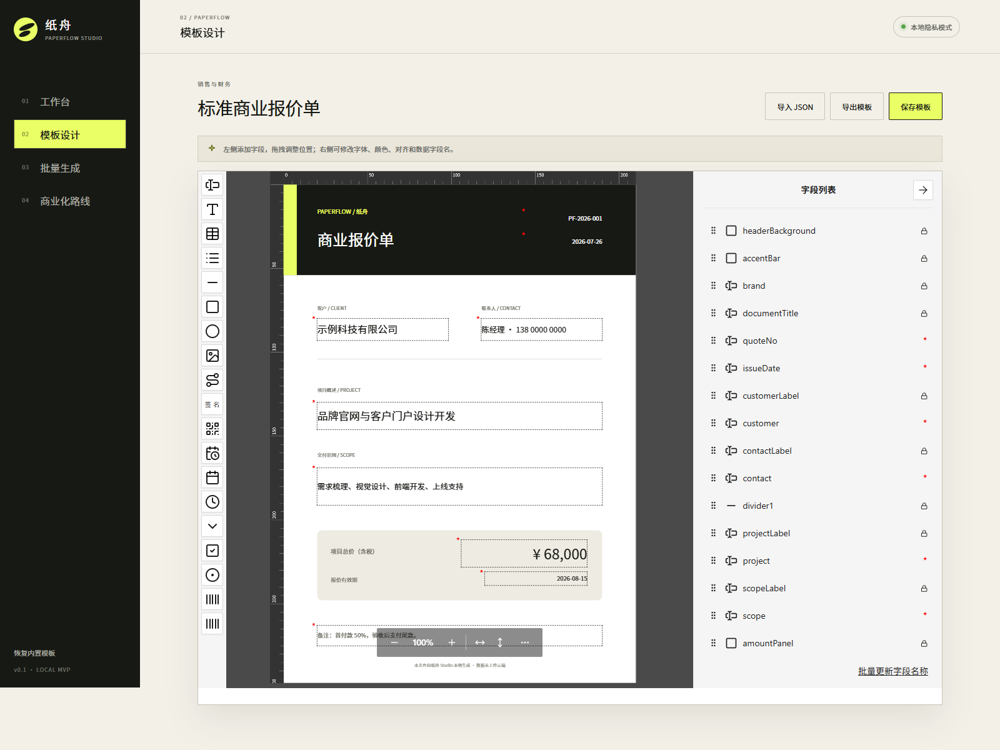
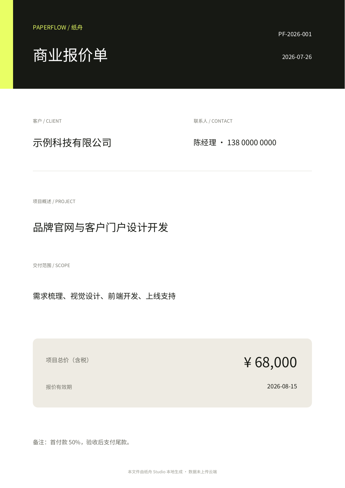

<p align="center">
  
</p>

<h1 align="center">纸舟 PaperFlow Studio</h1>

<p align="center">
  <strong>把重复文档，变成一次设计。</strong><br />
  本地优先的可视化 PDF 模板设计与批量生成工具。
</p>

<p align="center">
  <a href="https://zhang-ylong.github.io/paperflow-studio/"><strong>在线体验</strong></a>
  ·
  <a href="https://github.com/Zhang-YLong/paperflow-studio/releases/tag/v0.1.0-beta"><strong>下载 Windows Beta</strong></a>
  ·
  <a href="https://github.com/Zhang-YLong/paperflow-studio/issues"><strong>提交建议</strong></a>
</p>

<p align="center">
  
  
  
  
</p>



## 为什么是纸舟

报价单、证书、标签、通知单……很多业务文档只是数据不同，却每天都在重复排版。纸舟把这件事压缩成三步：

1. **设计一次**：在可视化画布中拖拽文字、图片、表格、二维码、签名和形状。
2. **导入数据**：粘贴或导入 CSV，每一行代表一份文档。
3. **批量生成**：一次下载合并后的 PDF，中文字体随应用本地提供。

> **隐私默认值：留在本机。** 当前 Beta 没有纸舟服务器，不要求登录，也不会把模板或业务数据上传给我们。

## 已经能做什么

| 能力 | 当前 Beta |
| --- | --- |
| 可视化模板设计 | 拖拽、编辑、保存与导入导出模板 |
| 批量文档生成 | CSV 一行一页，合并生成 PDF |
| 开箱即用模板 | 商业报价单、结业证书、发货标签 |
| 中文 PDF | 内置 Noto Sans CJK，不依赖在线字体 |
| 本地存储 | 模板修改保存在浏览器 `localStorage` |
| 桌面体验 | Windows 启动器 + PWA 安装 |

<table>
  <tr>
    <td width="50%"></td>
    <td width="50%"></td>
  </tr>
  <tr>
    <td align="center"><strong>可视化模板设计</strong></td>
    <td align="center"><strong>CSV 批量生成 PDF</strong></td>
  </tr>
</table>

## 60 秒开始

### 直接在线体验

打开 **[PaperFlow Studio 在线版](https://zhang-ylong.github.io/paperflow-studio/)**。所有编辑和生成仍在浏览器本地完成。

### Windows 本地版

1. 从 [v0.1.0 Beta](https://github.com/Zhang-YLong/paperflow-studio/releases/tag/v0.1.0-beta) 下载 ZIP 并解压。
2. 确认电脑已安装 [Node.js 20.19+](https://nodejs.org/)。
3. 双击 `启动纸舟Studio.cmd`。
4. 浏览器自动打开后，从“标准商业报价单”开始体验。

### 本地开发

```bash
git clone https://github.com/Zhang-YLong/paperflow-studio.git
cd paperflow-studio
npm ci
npm run dev
```

验证项目：

```bash
npm test
npm run build
```

## 适合谁

- 每周重复制作报价单、订单、证书或标签的中小团队
- 想给客户交付私有化文档工具的独立开发者
- 对数据出域敏感、暂时不考虑云端模板服务的组织
- 正在寻找 pdfme 中文业务示例的 React / TypeScript 开发者

## 路线图

- [x] 中文模板设计器与三套示例模板
- [x] CSV 批量生成与本地模板保存
- [x] Windows 本地启动器与在线体验
- [ ] 模板 JSON 版本管理与更稳健的恢复机制
- [ ] Excel 导入、字段映射与数据校验
- [ ] 独立桌面安装包（不再要求预装 Node.js）
- [ ] 团队版：权限、模板库与私有化部署

路线优先级由真实需求决定。欢迎在 [Issues](https://github.com/Zhang-YLong/paperflow-studio/issues) 投票或提出场景。

## 开源与商业化

纸舟 Studio 应用层采用 [MIT License](LICENSE)，可用于学习、修改、分发和商业项目；分发时请保留许可证和版权声明。核心 PDF 能力基于 [pdfme](https://github.com/pdfme/pdfme) `6.1.12`，字体采用 SIL Open Font License，详情见 [THIRD_PARTY_NOTICES.md](THIRD_PARTY_NOTICES.md) 与 [LICENSES](LICENSES)。

未来可通过合法渠道提供付费模板、桌面专业版、团队协作、私有化部署和技术服务。当前 Beta 不承诺生产级 SLA；正式用于关键业务前，请自行验证生成结果并完成适用地区的隐私、税务与行业合规评估。

## 参与项目

发现问题、希望增加模板，或想贡献代码，请阅读 [CONTRIBUTING.md](CONTRIBUTING.md)。安全问题请不要公开披露，处理方式见 [SECURITY.md](SECURITY.md)。

如果纸舟帮你少做了一次重复劳动，欢迎点一个 **Star**。它会告诉我们：这个方向值得继续认真做下去。
